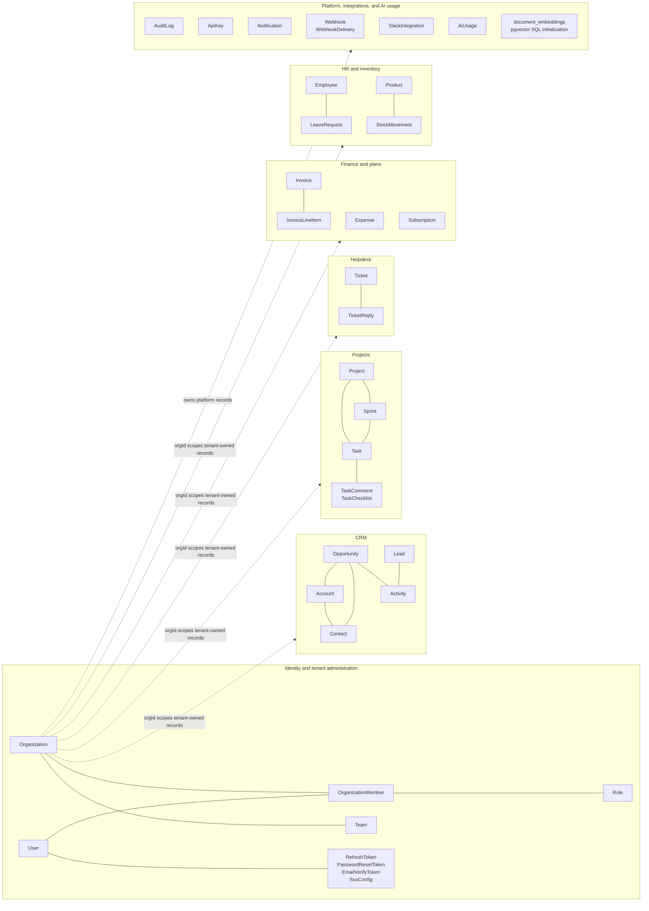
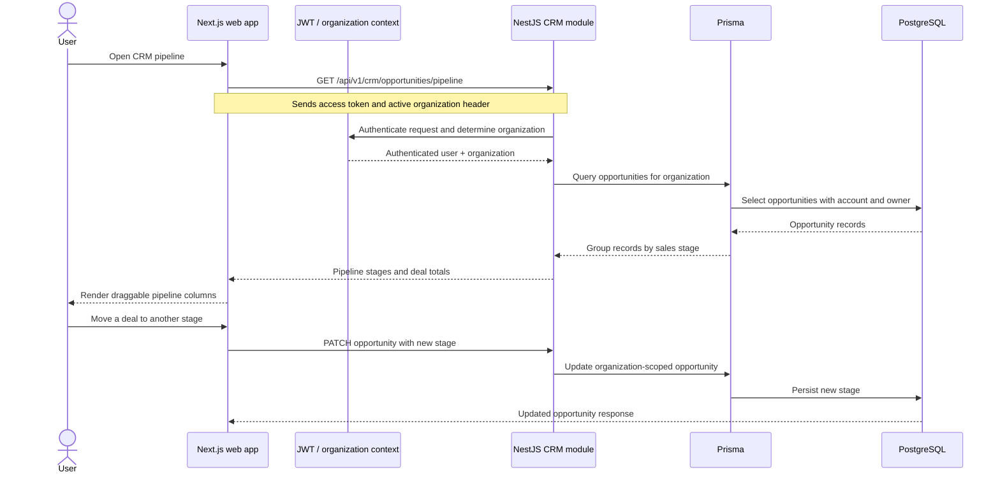
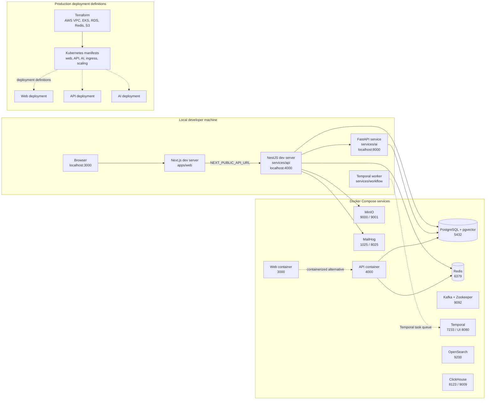
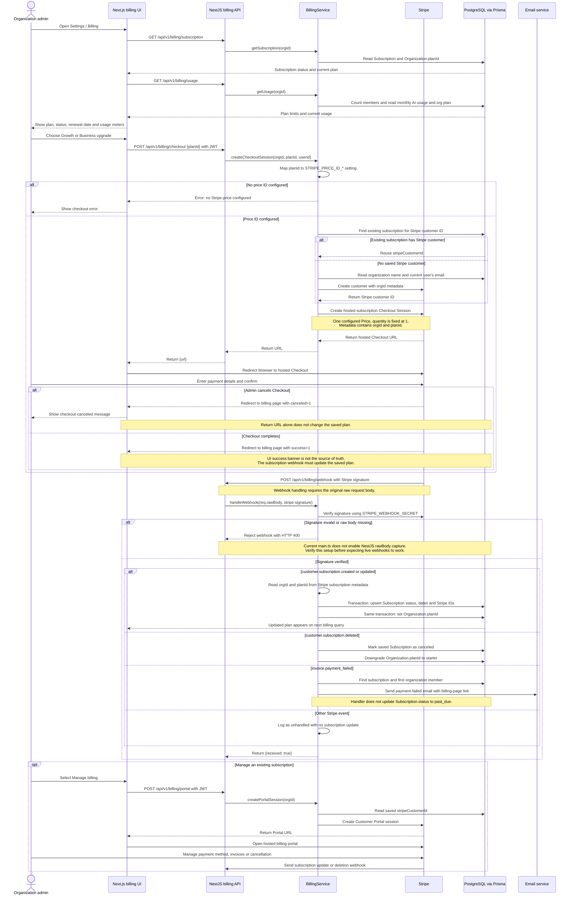

# Omnivara One — System Map

This guide shows how the repository is organised, how its main pieces relate, and
which parts are implemented versus planned. It describes the code and local
configuration in this repository; it is not a claim that every listed service is
production-ready or connected end to end.

## 1. The system at a glance

```mermaid
flowchart TB
    people["People<br/>business users and administrators"]

    subgraph clients [User-facing applications]
        web["Web app<br/>Next.js · apps/web<br/>public pages, login, business dashboard"]
        mobile["Mobile app<br/>Flutter · apps/mobile<br/>partial feature shell"]
        desktop["Desktop app<br/>Tauri · apps/desktop<br/>planned; intended to reuse web UI"]
    end

    subgraph shared [Shared TypeScript packages]
        config["packages/config<br/>plans, permissions, constants"]
        contracts["packages/contracts<br/>shared API and domain types"]
        ui["packages/ui<br/>reusable React components"]
    end

    subgraph backend [Backend services]
        api["Main API<br/>NestJS modular monolith<br/>services/api · REST /api/v1"]
        ai["AI service<br/>FastAPI · services/ai<br/>copilot, briefs, embeddings"]
        worker["Workflow worker<br/>Temporal TypeScript worker<br/>services/workflow"]
    end

    subgraph data [Data and runtime dependencies]
        postgres[("PostgreSQL 16<br/>Prisma business data<br/>pgvector extension")]
        redis[("Redis<br/>cache and optional runtime support")]
        vector[("document_embeddings<br/>pgvector table initialized by SQL script")]
    end

    subgraph integrations [Integration endpoints]
        email["SMTP email<br/>MailHog in local development"]
        objectstore["S3-compatible file storage<br/>MinIO locally"]
        model["LLM / embedding providers<br/>Anthropic or OpenAI keys optional"]
        stripe["Stripe<br/>billing integration"]
        slack["Slack and customer webhooks"]
    end

    people --> web
    people -.->|"partial client surface"| mobile
    people -.->|"planned"| desktop

    web -->|"HTTP JSON + JWT"| api
    mobile -.->|"API client surface"| api
    desktop -.->|"would use web/API"| api

    web -.->|"imports shared components"| ui
    web -.->|"uses shared types"| contracts
    web -.->|"uses shared configuration"| config
    api -.->|"uses shared contracts/config"| contracts
    api -.->|"uses plans and permissions"| config

    api -->|"Prisma queries"| postgres
    api -->|"cache when configured"| redis
    api -->|"HTTP calls for AI features"| ai
    ai -->|"vector search / brief queries"| postgres
    ai --> vector
    ai -.->|"when credentials are configured"| model

    api -->|"email service"| email
    api -->|"file storage service"| objectstore
    api -.->|"billing provider integration"| stripe
    api -->|"webhook and Slack modules"| slack

    worker -.->|"Temporal task queue"| temporal["Temporal server<br/>local Compose service"]
    api -.->|"Kafka is provisioned locally;<br/>not the default API event path"| kafka["Kafka + Zookeeper"]
    clickhouse["ClickHouse<br/>local Compose service"]
    opensearch["OpenSearch<br/>local Compose service"]
    api -.->|"not shown as the primary analytics/search store"| clickhouse
    api -.->|"search module exists;<br/>OpenSearch connection is not assumed"| opensearch

    classDef active fill:#e8f5e9,stroke:#388e3c,color:#1b5e20;
    classDef partial fill:#fff8e1,stroke:#f9a825,color:#5d4037;
    classDef planned fill:#f3e5f5,stroke:#8e24aa,color:#4a148c;
    class web,api,postgres,redis,ai active;
    class mobile,worker,vector,email,objectstore,model,stripe,slack partial;
    class desktop,kafka,clickhouse,opensearch planned;
```



**How to read the status colours:** green is the main implemented and runnable
path; yellow indicates optional, partially implemented, or configuration-
dependent components; purple indicates a planned surface or an infrastructure
container that should not be mistaken for a fully integrated application feature.
Dashed arrows indicate optional, partial, or not-yet-established connections.

## 2. What lives in the database

The API is a modular monolith: business areas are separate NestJS modules in one
API process and share one Prisma/PostgreSQL data layer. The model names below are
grouped to show the conceptual shape of the schema, not every field or relation.



The schema and application code use organization identifiers to scope tenant
data. Row-level security is described in [ADR-002](./adr-002-multi-tenancy.md);
check the current database migrations and policies before treating RLS as
enforced on every table.

## 3. Example request: viewing the CRM pipeline

This is a representative implemented web-to-database path. It illustrates the
architecture without implying that every screen or integration follows exactly
the same sequence.



The web client uses TanStack Query hooks for API calls and a Zustand auth store
for client-side authentication state. The API applies JWT authentication,
validation, rate limiting, and organization-scoped module queries.

## 4. Repository map

```mermaid
flowchart TB
    root["Omnivara monorepo<br/>pnpm workspaces + Turborepo"]

    root --> apps["apps/"]
    root --> services["services/"]
    root --> packages["packages/"]
    root --> infra["infra/"]
    root --> docs["docs/"]

    apps --> web["web/<br/>Next.js App Router<br/>CRM, projects, helpdesk, finance,<br/>HR, inventory, analytics, AI UI"]
    apps --> mobile["mobile/<br/>Flutter, Riverpod, GoRouter<br/>partial screens and API client"]
    apps --> desktop["desktop/<br/>Tauri shell<br/>planned"]

    services --> api["api/<br/>NestJS modules, Prisma schema,<br/>migrations, seed data, API tests"]
    services --> ai["ai/<br/>FastAPI routers, copilot,<br/>embeddings, briefs, Python tests"]
    services --> workflow["workflow/<br/>Temporal worker, activities,<br/>onboarding and invoice workflows"]

    packages --> ui["ui/<br/>shared React UI components"]
    packages --> contracts["contracts/<br/>shared TypeScript API/domain types"]
    packages --> config["config/<br/>constants, permissions, plans"]

    root --> compose["docker-compose.yml<br/>local development dependencies"]
    infra --> docker["docker/postgres/<br/>PostgreSQL extensions and vector setup"]
    infra --> terraform["terraform/<br/>AWS infrastructure definitions"]
    infra --> kubernetes["k8s/<br/>Kubernetes manifests"]

    docs --> adrs["architecture/<br/>architecture decision records"]
    docs --> map["architecture/system-map.md<br/>this guide"]
```



## 5. Local development and deployment shape



Compose defines more services than the minimum local run needs. The currently
verified local path uses the web app, NestJS API, PostgreSQL, Redis, and seeded
demo data. Kafka, ClickHouse, OpenSearch, Temporal, MinIO, and MailHog are
configured in Compose, but their presence there alone does not mean every
application module depends on or fully uses them. Kubernetes and Terraform are
deployment definitions, not proof of a deployed cloud environment.

## 6. How subscription billing and payments work

This diagram describes **Omnivara plan subscriptions** (the SaaS charge for using
the platform), not invoices that an Omnivara customer creates for their own
clients in the Finance module.



### What controls access after payment

The organization’s `planId` is the local plan decision used by application
features. A verified subscription-created or subscription-updated webhook writes
the subscription record and the organization plan together. API modules can then
read that plan and its limits from `packages/config/src/plans.ts`; for example,
the AI service checks plan access and monthly credits. The browser returning to
the `success=1` URL does not itself activate the plan.

### Current implementation details and limitations

- The web UI offers paid Growth and Business checkout. Enterprise is routed to
  sales rather than Stripe Checkout. The API has configured price-ID lookups for
  Starter, Growth and Business, but a real Stripe account and real price IDs are
  required for checkout.
- The API creates subscription-mode Stripe Checkout Sessions with one price and
  `quantity: 1`. Although some UI copy describes per-user pricing, this path does
  not calculate the organisation's member count as the checkout quantity.
- Subscription-created and subscription-updated events update the stored plan.
  Subscription deletion marks the record canceled and downgrades the org to
  Starter. Payment failure sends an email, but the current handler does not set
  the stored subscription status to `past_due`.
- The webhook controller passes `req.rawBody` to Stripe signature verification,
  but `services/api/src/main.ts` does not enable Nest's `rawBody` option. Verify
  or fix raw-body capture before relying on live webhook delivery.
- Stripe secret, price IDs and webhook signing secret must be valid and
  configured. The local demo environment has no live payment processing.

## 7. Complete database schema

These two diagrams are generated from the current Prisma schema and show all 36
Prisma models, their 434 persisted scalar fields, and the 65 foreign-key
relationships defined through Prisma relation fields. The class diagram also
lists every value of the 15 enums. `document_embeddings` is included separately:
it is created by the PostgreSQL initialization SQL rather than by Prisma.


This view emphasizes tables, keys, and relationship cardinality. `PK`, `FK`, and
`UK` mark primary, foreign, and single-column unique keys. A `?` on a field type
means nullable, and `[]` means an array. Field notes show Prisma defaults and
native database types where configured.

```mermaid
erDiagram
    %% Prisma models and columns; relation fields are shown as connector lines.
    Organization ||--o| SsoConfig : SsoConfig_org
    Organization ||--o{ OrganizationMember : OrganizationMember_org
    User ||--o{ OrganizationMember : OrganizationMember_user
    Role ||--o{ OrganizationMember : OrganizationMember_role
    Organization ||--o{ Team : Team_org
    Organization o|--o{ Role : Role_org
    User ||--o{ RefreshToken : RefreshToken_user
    User ||--o| PasswordResetToken : PasswordResetToken_user
    User ||--o| EmailVerifyToken : EmailVerifyToken_user
    Organization ||--o{ AuditLog : AuditLog_org
    User o|--o{ AuditLog : AuditLog_user
    Organization ||--o{ ApiKey : ApiKey_org
    Organization ||--o{ Lead : Lead_org
    User o|--o{ Lead : Lead_owner
    Organization ||--o{ Contact : Contact_org
    Account o|--o{ Contact : Contact_account
    User o|--o{ Contact : Contact_owner
    Organization ||--o{ Account : Account_org
    User o|--o{ Account : Account_owner
    Organization ||--o{ Opportunity : Opportunity_org
    Account o|--o{ Opportunity : Opportunity_account
    Contact o|--o{ Opportunity : Opportunity_contact
    User o|--o{ Opportunity : Opportunity_owner
    Organization ||--o{ Activity : Activity_org
    User o|--o{ Activity : Activity_user
    Lead o|--o{ Activity : Activity_lead
    Contact o|--o{ Activity : Activity_contact
    Account o|--o{ Activity : Activity_account
    Opportunity o|--o{ Activity : Activity_opportunity
    Ticket o|--o{ Activity : Activity_ticket
    Organization ||--o{ Project : Project_org
    Project ||--o{ Sprint : Sprint_project
    Organization ||--o{ Task : Task_org
    Project ||--o{ Task : Task_project
    Sprint o|--o{ Task : Task_sprint
    User o|--o{ Task : Task_assignee
    Task ||--o{ TaskComment : TaskComment_task
    Organization ||--o{ TaskComment : TaskComment_org
    User ||--o{ TaskComment : TaskComment_author
    Task ||--o{ TaskChecklist : TaskChecklist_task
    Organization ||--o{ TaskChecklist : TaskChecklist_org
    Organization ||--o{ Ticket : Ticket_org
    Contact o|--o{ Ticket : Ticket_contact
    User o|--o{ Ticket : Ticket_assignee
    Team o|--o{ Ticket : Ticket_team
    Ticket ||--o{ TicketReply : TicketReply_ticket
    Organization ||--o{ TicketReply : TicketReply_org
    User o|--o{ TicketReply : TicketReply_author
    Organization ||--o{ Invoice : Invoice_org
    Account o|--o{ Invoice : Invoice_account
    Invoice ||--o{ InvoiceLineItem : InvoiceLineItem_invoice
    Organization ||--o{ Expense : Expense_org
    Organization ||--o{ Employee : Employee_org
    Employee o|--o{ Employee : Employee_manager
    Organization ||--o{ LeaveRequest : LeaveRequest_org
    Employee ||--o{ LeaveRequest : LeaveRequest_employee
    Organization ||--o{ Product : Product_org
    Organization ||--o{ StockMovement : StockMovement_org
    Product ||--o{ StockMovement : StockMovement_product
    Organization ||--o| Subscription : Subscription_org
    Organization ||--o{ AiUsage : AiUsage_org
    Organization ||--o{ Webhook : Webhook_org
    Webhook ||--o{ WebhookDelivery : WebhookDelivery_webhook
    Organization ||--o| SlackIntegration : SlackIntegration_org
    Organization ||--o{ Notification : Notification_org

    Organization {
        String id PK "table: organizations; default: cuid()"
        String name
        String slug UK
        String? domain UK
        String? logoUrl
        String planId "default: 'starter'"
        Json settings "default: '{}'"
        DateTime createdAt "default: now()"
        DateTime updatedAt "updatedAt"
        OrganizationMember[] users
        Team[] teams
        Role[] roles
        AuditLog[] auditLogs
        Lead[] leads
        Contact[] contacts
        Account[] accounts
        Opportunity[] opportunities
        Activity[] activities
        Project[] projects
        Task[] tasks
        Ticket[] tickets
        TicketReply[] ticketReplies
        Invoice[] invoices
        Expense[] expenses
        Employee[] employees
        LeaveRequest[] leaveRequests
        Product[] products
        StockMovement[] stockMovements
        TaskComment[] taskComments
        TaskChecklist[] taskChecklists
        Subscription? subscription
        AiUsage[] aiUsage
        ApiKey[] apiKeys
        SsoConfig? ssoConfig
        Webhook[] webhooks
        SlackIntegration? slackIntegration
        Notification[] notifications
    }
    SsoConfig {
        String id PK "table: sso_configs; default: cuid()"
        String orgId FK, UK
        String provider "default: 'saml'"
        String entryPoint
        String issuer
        String cert "native: Text"
        Boolean enabled "default: false"
        DateTime createdAt "default: now()"
        DateTime updatedAt "updatedAt"
    }
    User {
        String id PK "table: users; default: cuid()"
        String email UK
        Boolean emailVerified "default: false"
        String name
        String? avatarUrl
        String? passwordHash
        DateTime? lastLoginAt
        DateTime createdAt "default: now()"
        DateTime updatedAt "updatedAt"
        OrganizationMember[] orgs
        RefreshToken[] refreshTokens
        PasswordResetToken? passwordResetToken
        EmailVerifyToken? emailVerifyToken
        AuditLog[] auditLogs
        Lead[] ownedLeads
        Contact[] ownedContacts
        Account[] ownedAccounts
        Opportunity[] ownedOpps
        Activity[] activities
        Task[] assignedTasks
        Ticket[] assignedTickets
        TicketReply[] ticketReplies
    }
    OrganizationMember {
        String id PK "table: organization_members; default: cuid()"
        String orgId FK
        String userId FK
        String roleId FK
        DateTime joinedAt "default: now()"
    }
    Team {
        String id PK "table: teams; default: cuid()"
        String orgId FK
        String name
        String? description
        DateTime createdAt "default: now()"
        DateTime updatedAt "updatedAt"
        Ticket[] tickets
    }
    Role {
        String id PK "table: roles; default: cuid()"
        String? orgId FK
        String name
        String? description
        String[] permissions
        Boolean isSystem "default: false"
        DateTime createdAt "default: now()"
        DateTime updatedAt "updatedAt"
        OrganizationMember[] members
    }
    RefreshToken {
        String id PK "table: refresh_tokens; default: cuid()"
        String userId FK
        String token UK
        DateTime expiresAt
        Boolean revoked "default: false"
        DateTime createdAt "default: now()"
    }
    PasswordResetToken {
        String id PK "table: password_reset_tokens; default: cuid()"
        String userId FK, UK
        String token UK
        DateTime expiresAt
        Boolean used "default: false"
        DateTime createdAt "default: now()"
    }
    EmailVerifyToken {
        String id PK "table: email_verify_tokens; default: cuid()"
        String userId FK, UK
        String token UK
        DateTime expiresAt
        DateTime createdAt "default: now()"
    }
    AuditLog {
        String id PK "table: audit_logs; default: cuid()"
        String orgId FK
        String? userId FK
        String action
        String? resourceId
        String? resourceType
        Json? before
        Json? after
        String? ipAddress
        String? userAgent
        DateTime createdAt "default: now()"
    }
    ApiKey {
        String id PK "table: api_keys; default: cuid()"
        String orgId FK
        String name
        String keyHash UK
        String prefix
        DateTime? lastUsed
        DateTime? expiresAt
        String createdBy
        DateTime createdAt "default: now()"
    }
    Lead {
        String id PK "table: leads; default: cuid()"
        String orgId FK
        String name
        String? email
        String? phone
        String? company
        String? title
        LeadStatus status "default: new"
        String? source
        String? notes
        String? ownerId FK
        DateTime? convertedAt
        DateTime createdAt "default: now()"
        DateTime updatedAt "updatedAt"
        Activity[] activities
    }
    Contact {
        String id PK "table: contacts; default: cuid()"
        String orgId FK
        String name
        String? email
        String? phone
        String? title
        String? department
        String? accountId FK
        String? ownerId FK
        String[] tags
        DateTime createdAt "default: now()"
        DateTime updatedAt "updatedAt"
        Opportunity[] opportunities
        Activity[] activities
        Ticket[] tickets
    }
    Account {
        String id PK "table: accounts; default: cuid()"
        String orgId FK
        String name
        String? domain
        String? industry
        Int? employeeCount
        Decimal? annualRevenue "native: Decimal(15, 2)"
        String currency "default: 'USD'"
        String? website
        Json? address
        String? ownerId FK
        String[] tags
        DateTime createdAt "default: now()"
        DateTime updatedAt "updatedAt"
        Contact[] contacts
        Opportunity[] opportunities
        Activity[] activities
        Invoice[] invoices
    }
    Opportunity {
        String id PK "table: opportunities; default: cuid()"
        String orgId FK
        String name
        String? accountId FK
        String? contactId FK
        OpportunityStage stage "default: prospecting"
        Decimal? amount "native: Decimal(15, 2)"
        String currency "default: 'USD'"
        Int? probability
        DateTime? expectedCloseDate
        DateTime? actualCloseDate
        String? ownerId FK
        String? lostReason
        String? description
        String[] tags
        DateTime createdAt "default: now()"
        DateTime updatedAt "updatedAt"
        Activity[] activities
    }
    Activity {
        String id PK "table: activities; default: cuid()"
        String orgId FK
        ActivityType type
        String subject
        String? body
        DateTime? dueAt
        DateTime? completedAt
        Int? duration
        String? userId FK
        String? leadId FK
        String? contactId FK
        String? accountId FK
        String? opportunityId FK
        String? ticketId FK
        DateTime createdAt "default: now()"
        DateTime updatedAt "updatedAt"
    }
    Project {
        String id PK "table: projects; default: cuid()"
        String orgId FK
        String name
        String? description
        String status "default: 'active'"
        String? ownerId
        DateTime? startDate
        DateTime? endDate
        DateTime createdAt "default: now()"
        DateTime updatedAt "updatedAt"
        Task[] tasks
        Sprint[] sprints
    }
    Sprint {
        String id PK "table: sprints; default: cuid()"
        String projectId FK
        String name
        String? goal
        DateTime startDate
        DateTime endDate
        String status "default: 'planning'"
        DateTime createdAt "default: now()"
        DateTime updatedAt "updatedAt"
        Task[] tasks
    }
    Task {
        String id PK "table: tasks; default: cuid()"
        String orgId FK
        String projectId FK
        String? sprintId FK
        String title
        String? description
        TaskStatus status "default: backlog"
        TaskPriority priority "default: medium"
        String? assigneeId FK
        DateTime? dueDate
        Decimal? estimatedHours "native: Decimal(5, 2)"
        DateTime createdAt "default: now()"
        DateTime updatedAt "updatedAt"
        TaskComment[] comments
        TaskChecklist[] checklist
    }
    TaskComment {
        String id PK "table: task_comments; default: cuid()"
        String taskId FK
        String orgId FK
        String authorId FK
        String content
        DateTime createdAt "default: now()"
        DateTime updatedAt "updatedAt"
    }
    TaskChecklist {
        String id PK "table: task_checklist; default: cuid()"
        String taskId FK
        String orgId FK
        String text
        Boolean done "default: false"
        Int position "default: 0"
        DateTime createdAt "default: now()"
        DateTime updatedAt "updatedAt"
    }
    Ticket {
        String id PK "table: tickets; default: cuid()"
        String orgId FK
        String subject
        String? description
        TicketStatus status "default: open"
        TicketPriority priority "default: medium"
        TicketChannel channel "default: email"
        String? contactId FK
        String? assigneeId FK
        String? teamId FK
        DateTime? slaBreachAt
        DateTime? resolvedAt
        DateTime createdAt "default: now()"
        DateTime updatedAt "updatedAt"
        Activity[] activities
        TicketReply[] replies
    }
    TicketReply {
        String id PK "table: ticket_replies; default: cuid()"
        String ticketId FK
        String orgId FK
        String? authorId FK
        String authorName
        Boolean isAgent "default: false"
        String body
        DateTime createdAt "default: now()"
    }
    Invoice {
        String id PK "table: invoices; default: cuid()"
        String orgId FK
        String number
        InvoiceStatus status "default: draft"
        String? accountId FK
        String currency "default: 'USD'"
        Decimal subtotal "native: Decimal(15, 2)"
        Decimal taxAmount "default: 0; native: Decimal(15, 2)"
        Decimal total "native: Decimal(15, 2)"
        DateTime? dueDate
        DateTime? paidAt
        String? notes
        DateTime createdAt "default: now()"
        DateTime updatedAt "updatedAt"
        InvoiceLineItem[] lineItems
    }
    InvoiceLineItem {
        String id PK "table: invoice_line_items; default: cuid()"
        String invoiceId FK
        String description
        Decimal quantity "native: Decimal(10, 3)"
        Decimal unitPrice "native: Decimal(15, 2)"
        Decimal amount "native: Decimal(15, 2)"
    }
    Expense {
        String id PK "table: expenses; default: cuid()"
        String orgId FK
        String submittedBy
        String title
        String category
        Decimal amount "native: Decimal(15, 2)"
        String currency "default: 'USD'"
        DateTime date
        String? vendor
        String? receiptUrl
        String? notes
        ExpenseStatus status "default: draft"
        String? reviewedBy
        DateTime? reviewedAt
        DateTime createdAt "default: now()"
        DateTime updatedAt "updatedAt"
    }
    Employee {
        String id PK "table: employees; default: cuid()"
        String orgId FK
        String? userId
        String? employeeNumber
        String firstName
        String lastName
        String email
        String? phone
        String jobTitle
        String department
        String? location
        String? managerId FK
        EmploymentStatus status "default: active"
        DateTime startDate
        DateTime? endDate
        Decimal? salary "native: Decimal(15, 2)"
        String currency "default: 'USD'"
        DateTime createdAt "default: now()"
        DateTime updatedAt "updatedAt"
        LeaveRequest[] leaveRequests
    }
    LeaveRequest {
        String id PK "table: leave_requests; default: cuid()"
        String orgId FK
        String employeeId FK
        LeaveType type
        DateTime startDate
        DateTime endDate
        Int days
        String? reason
        LeaveRequestStatus status "default: pending"
        String? reviewedBy
        DateTime? reviewedAt
        DateTime createdAt "default: now()"
        DateTime updatedAt "updatedAt"
    }
    Product {
        String id PK "table: products; default: cuid()"
        String orgId FK
        String sku
        String name
        String? description
        String? category
        Decimal unitCost "default: 0; native: Decimal(15, 2)"
        Decimal salePrice "default: 0; native: Decimal(15, 2)"
        Int stockQuantity "default: 0"
        Int reorderPoint "default: 0"
        Int reorderQuantity "default: 0"
        String? warehouseLocation
        String? supplierId
        StockStatus status "default: in_stock"
        DateTime createdAt "default: now()"
        DateTime updatedAt "updatedAt"
        StockMovement[] stockMovements
    }
    StockMovement {
        String id PK "table: stock_movements; default: cuid()"
        String orgId FK
        String productId FK
        Int quantity
        String type
        String? reference
        String? notes
        String? performedBy
        DateTime createdAt "default: now()"
    }
    Subscription {
        String id PK "table: subscriptions; default: cuid()"
        String orgId FK, UK
        String stripeCustomerId
        String stripeSubId UK
        String planId "default: 'starter'"
        SubStatus status "default: active"
        DateTime currentPeriodEnd
        Boolean cancelAtPeriodEnd "default: false"
        DateTime createdAt "default: now()"
        DateTime updatedAt "updatedAt"
    }
    AiUsage {
        String id PK "table: ai_usage; default: cuid()"
        String orgId FK
        String month
        Int messages "default: 0"
        Int tokens "default: 0"
        DateTime createdAt "default: now()"
        DateTime updatedAt "updatedAt"
    }
    Webhook {
        String id PK "table: webhooks; default: cuid()"
        String orgId FK
        String url
        String[] events
        String secret
        Boolean active "default: true"
        DateTime createdAt "default: now()"
        DateTime updatedAt "updatedAt"
        WebhookDelivery[] deliveries
    }
    WebhookDelivery {
        String id PK "table: webhook_deliveries; default: cuid()"
        String webhookId FK
        String event
        Json payload
        String status "default: 'pending'"
        Int? statusCode
        String? responseBody
        Int attempts "default: 0"
        DateTime? deliveredAt
        DateTime createdAt "default: now()"
    }
    SlackIntegration {
        String id PK "table: slack_integrations; default: cuid()"
        String orgId FK, UK
        String accessToken
        String channelId
        String channelName
        String installedBy
        DateTime createdAt "default: now()"
        DateTime updatedAt "updatedAt"
    }
    Notification {
        String id PK "table: notifications; default: cuid()"
        String orgId FK
        String? userId
        String type
        String title
        String body
        String? url
        Boolean read "default: false"
        DateTime? readAt
        DateTime createdAt "default: now()"
    }

    document_embeddings {
        UUID id PK "default: uuid_generate_v4()"
        TEXT org_id
        TEXT document_id
        TEXT document_type
        TEXT content
        vector embedding "vector(1536)"
        JSONB metadata "default: {}"
        TIMESTAMPTZ created_at "default: now()"
        TIMESTAMPTZ updated_at "default: now(); trigger updates on change"
    }
```


This view emphasizes each model’s attributes and how entities connect. The
enumerations are shown as classes marked `enumeration`.

```mermaid
classDiagram
    direction LR
    class Organization {
        +id: String <<PK>>
        +name: String
        +slug: String <<UK>>
        +domain: String? <<UK>>
        +logoUrl: String?
        +planId: String
        +settings: Json
        +createdAt: DateTime
        +updatedAt: DateTime
        +users: OrganizationMember[]
        +teams: Team[]
        +roles: Role[]
        +auditLogs: AuditLog[]
        +leads: Lead[]
        +contacts: Contact[]
        +accounts: Account[]
        +opportunities: Opportunity[]
        +activities: Activity[]
        +projects: Project[]
        +tasks: Task[]
        +tickets: Ticket[]
        +ticketReplies: TicketReply[]
        +invoices: Invoice[]
        +expenses: Expense[]
        +employees: Employee[]
        +leaveRequests: LeaveRequest[]
        +products: Product[]
        +stockMovements: StockMovement[]
        +taskComments: TaskComment[]
        +taskChecklists: TaskChecklist[]
        +subscription: Subscription?
        +aiUsage: AiUsage[]
        +apiKeys: ApiKey[]
        +ssoConfig: SsoConfig?
        +webhooks: Webhook[]
        +slackIntegration: SlackIntegration?
        +notifications: Notification[]
    }
    class SsoConfig {
        +id: String <<PK>>
        +orgId: String <<FK, UK>>
        +provider: String
        +entryPoint: String
        +issuer: String
        +cert: String
        +enabled: Boolean
        +createdAt: DateTime
        +updatedAt: DateTime
    }
    class User {
        +id: String <<PK>>
        +email: String <<UK>>
        +emailVerified: Boolean
        +name: String
        +avatarUrl: String?
        +passwordHash: String?
        +lastLoginAt: DateTime?
        +createdAt: DateTime
        +updatedAt: DateTime
        +orgs: OrganizationMember[]
        +refreshTokens: RefreshToken[]
        +passwordResetToken: PasswordResetToken?
        +emailVerifyToken: EmailVerifyToken?
        +auditLogs: AuditLog[]
        +ownedLeads: Lead[]
        +ownedContacts: Contact[]
        +ownedAccounts: Account[]
        +ownedOpps: Opportunity[]
        +activities: Activity[]
        +assignedTasks: Task[]
        +assignedTickets: Ticket[]
        +ticketReplies: TicketReply[]
    }
    class OrganizationMember {
        +id: String <<PK>>
        +orgId: String <<FK>>
        +userId: String <<FK>>
        +roleId: String <<FK>>
        +joinedAt: DateTime
    }
    class Team {
        +id: String <<PK>>
        +orgId: String <<FK>>
        +name: String
        +description: String?
        +createdAt: DateTime
        +updatedAt: DateTime
        +tickets: Ticket[]
    }
    class Role {
        +id: String <<PK>>
        +orgId: String? <<FK>>
        +name: String
        +description: String?
        +permissions: String[]
        +isSystem: Boolean
        +createdAt: DateTime
        +updatedAt: DateTime
        +members: OrganizationMember[]
    }
    class RefreshToken {
        +id: String <<PK>>
        +userId: String <<FK>>
        +token: String <<UK>>
        +expiresAt: DateTime
        +revoked: Boolean
        +createdAt: DateTime
    }
    class PasswordResetToken {
        +id: String <<PK>>
        +userId: String <<FK, UK>>
        +token: String <<UK>>
        +expiresAt: DateTime
        +used: Boolean
        +createdAt: DateTime
    }
    class EmailVerifyToken {
        +id: String <<PK>>
        +userId: String <<FK, UK>>
        +token: String <<UK>>
        +expiresAt: DateTime
        +createdAt: DateTime
    }
    class AuditLog {
        +id: String <<PK>>
        +orgId: String <<FK>>
        +userId: String? <<FK>>
        +action: String
        +resourceId: String?
        +resourceType: String?
        +before: Json?
        +after: Json?
        +ipAddress: String?
        +userAgent: String?
        +createdAt: DateTime
    }
    class ApiKey {
        +id: String <<PK>>
        +orgId: String <<FK>>
        +name: String
        +keyHash: String <<UK>>
        +prefix: String
        +lastUsed: DateTime?
        +expiresAt: DateTime?
        +createdBy: String
        +createdAt: DateTime
    }
    class Lead {
        +id: String <<PK>>
        +orgId: String <<FK>>
        +name: String
        +email: String?
        +phone: String?
        +company: String?
        +title: String?
        +status: LeadStatus
        +source: String?
        +notes: String?
        +ownerId: String? <<FK>>
        +convertedAt: DateTime?
        +createdAt: DateTime
        +updatedAt: DateTime
        +activities: Activity[]
    }
    class Contact {
        +id: String <<PK>>
        +orgId: String <<FK>>
        +name: String
        +email: String?
        +phone: String?
        +title: String?
        +department: String?
        +accountId: String? <<FK>>
        +ownerId: String? <<FK>>
        +tags: String[]
        +createdAt: DateTime
        +updatedAt: DateTime
        +opportunities: Opportunity[]
        +activities: Activity[]
        +tickets: Ticket[]
    }
    class Account {
        +id: String <<PK>>
        +orgId: String <<FK>>
        +name: String
        +domain: String?
        +industry: String?
        +employeeCount: Int?
        +annualRevenue: Decimal?
        +currency: String
        +website: String?
        +address: Json?
        +ownerId: String? <<FK>>
        +tags: String[]
        +createdAt: DateTime
        +updatedAt: DateTime
        +contacts: Contact[]
        +opportunities: Opportunity[]
        +activities: Activity[]
        +invoices: Invoice[]
    }
    class Opportunity {
        +id: String <<PK>>
        +orgId: String <<FK>>
        +name: String
        +accountId: String? <<FK>>
        +contactId: String? <<FK>>
        +stage: OpportunityStage
        +amount: Decimal?
        +currency: String
        +probability: Int?
        +expectedCloseDate: DateTime?
        +actualCloseDate: DateTime?
        +ownerId: String? <<FK>>
        +lostReason: String?
        +description: String?
        +tags: String[]
        +createdAt: DateTime
        +updatedAt: DateTime
        +activities: Activity[]
    }
    class Activity {
        +id: String <<PK>>
        +orgId: String <<FK>>
        +type: ActivityType
        +subject: String
        +body: String?
        +dueAt: DateTime?
        +completedAt: DateTime?
        +duration: Int?
        +userId: String? <<FK>>
        +leadId: String? <<FK>>
        +contactId: String? <<FK>>
        +accountId: String? <<FK>>
        +opportunityId: String? <<FK>>
        +ticketId: String? <<FK>>
        +createdAt: DateTime
        +updatedAt: DateTime
    }
    class Project {
        +id: String <<PK>>
        +orgId: String <<FK>>
        +name: String
        +description: String?
        +status: String
        +ownerId: String?
        +startDate: DateTime?
        +endDate: DateTime?
        +createdAt: DateTime
        +updatedAt: DateTime
        +tasks: Task[]
        +sprints: Sprint[]
    }
    class Sprint {
        +id: String <<PK>>
        +projectId: String <<FK>>
        +name: String
        +goal: String?
        +startDate: DateTime
        +endDate: DateTime
        +status: String
        +createdAt: DateTime
        +updatedAt: DateTime
        +tasks: Task[]
    }
    class Task {
        +id: String <<PK>>
        +orgId: String <<FK>>
        +projectId: String <<FK>>
        +sprintId: String? <<FK>>
        +title: String
        +description: String?
        +status: TaskStatus
        +priority: TaskPriority
        +assigneeId: String? <<FK>>
        +dueDate: DateTime?
        +estimatedHours: Decimal?
        +createdAt: DateTime
        +updatedAt: DateTime
        +comments: TaskComment[]
        +checklist: TaskChecklist[]
    }
    class TaskComment {
        +id: String <<PK>>
        +taskId: String <<FK>>
        +orgId: String <<FK>>
        +authorId: String <<FK>>
        +content: String
        +createdAt: DateTime
        +updatedAt: DateTime
    }
    class TaskChecklist {
        +id: String <<PK>>
        +taskId: String <<FK>>
        +orgId: String <<FK>>
        +text: String
        +done: Boolean
        +position: Int
        +createdAt: DateTime
        +updatedAt: DateTime
    }
    class Ticket {
        +id: String <<PK>>
        +orgId: String <<FK>>
        +subject: String
        +description: String?
        +status: TicketStatus
        +priority: TicketPriority
        +channel: TicketChannel
        +contactId: String? <<FK>>
        +assigneeId: String? <<FK>>
        +teamId: String? <<FK>>
        +slaBreachAt: DateTime?
        +resolvedAt: DateTime?
        +createdAt: DateTime
        +updatedAt: DateTime
        +activities: Activity[]
        +replies: TicketReply[]
    }
    class TicketReply {
        +id: String <<PK>>
        +ticketId: String <<FK>>
        +orgId: String <<FK>>
        +authorId: String? <<FK>>
        +authorName: String
        +isAgent: Boolean
        +body: String
        +createdAt: DateTime
    }
    class Invoice {
        +id: String <<PK>>
        +orgId: String <<FK>>
        +number: String
        +status: InvoiceStatus
        +accountId: String? <<FK>>
        +currency: String
        +subtotal: Decimal
        +taxAmount: Decimal
        +total: Decimal
        +dueDate: DateTime?
        +paidAt: DateTime?
        +notes: String?
        +createdAt: DateTime
        +updatedAt: DateTime
        +lineItems: InvoiceLineItem[]
    }
    class InvoiceLineItem {
        +id: String <<PK>>
        +invoiceId: String <<FK>>
        +description: String
        +quantity: Decimal
        +unitPrice: Decimal
        +amount: Decimal
    }
    class Expense {
        +id: String <<PK>>
        +orgId: String <<FK>>
        +submittedBy: String
        +title: String
        +category: String
        +amount: Decimal
        +currency: String
        +date: DateTime
        +vendor: String?
        +receiptUrl: String?
        +notes: String?
        +status: ExpenseStatus
        +reviewedBy: String?
        +reviewedAt: DateTime?
        +createdAt: DateTime
        +updatedAt: DateTime
    }
    class Employee {
        +id: String <<PK>>
        +orgId: String <<FK>>
        +userId: String?
        +employeeNumber: String?
        +firstName: String
        +lastName: String
        +email: String
        +phone: String?
        +jobTitle: String
        +department: String
        +location: String?
        +managerId: String? <<FK>>
        +status: EmploymentStatus
        +startDate: DateTime
        +endDate: DateTime?
        +salary: Decimal?
        +currency: String
        +createdAt: DateTime
        +updatedAt: DateTime
        +leaveRequests: LeaveRequest[]
    }
    class LeaveRequest {
        +id: String <<PK>>
        +orgId: String <<FK>>
        +employeeId: String <<FK>>
        +type: LeaveType
        +startDate: DateTime
        +endDate: DateTime
        +days: Int
        +reason: String?
        +status: LeaveRequestStatus
        +reviewedBy: String?
        +reviewedAt: DateTime?
        +createdAt: DateTime
        +updatedAt: DateTime
    }
    class Product {
        +id: String <<PK>>
        +orgId: String <<FK>>
        +sku: String
        +name: String
        +description: String?
        +category: String?
        +unitCost: Decimal
        +salePrice: Decimal
        +stockQuantity: Int
        +reorderPoint: Int
        +reorderQuantity: Int
        +warehouseLocation: String?
        +supplierId: String?
        +status: StockStatus
        +createdAt: DateTime
        +updatedAt: DateTime
        +stockMovements: StockMovement[]
    }
    class StockMovement {
        +id: String <<PK>>
        +orgId: String <<FK>>
        +productId: String <<FK>>
        +quantity: Int
        +type: String
        +reference: String?
        +notes: String?
        +performedBy: String?
        +createdAt: DateTime
    }
    class Subscription {
        +id: String <<PK>>
        +orgId: String <<FK, UK>>
        +stripeCustomerId: String
        +stripeSubId: String <<UK>>
        +planId: String
        +status: SubStatus
        +currentPeriodEnd: DateTime
        +cancelAtPeriodEnd: Boolean
        +createdAt: DateTime
        +updatedAt: DateTime
    }
    class AiUsage {
        +id: String <<PK>>
        +orgId: String <<FK>>
        +month: String
        +messages: Int
        +tokens: Int
        +createdAt: DateTime
        +updatedAt: DateTime
    }
    class Webhook {
        +id: String <<PK>>
        +orgId: String <<FK>>
        +url: String
        +events: String[]
        +secret: String
        +active: Boolean
        +createdAt: DateTime
        +updatedAt: DateTime
        +deliveries: WebhookDelivery[]
    }
    class WebhookDelivery {
        +id: String <<PK>>
        +webhookId: String <<FK>>
        +event: String
        +payload: Json
        +status: String
        +statusCode: Int?
        +responseBody: String?
        +attempts: Int
        +deliveredAt: DateTime?
        +createdAt: DateTime
    }
    class SlackIntegration {
        +id: String <<PK>>
        +orgId: String <<FK, UK>>
        +accessToken: String
        +channelId: String
        +channelName: String
        +installedBy: String
        +createdAt: DateTime
        +updatedAt: DateTime
    }
    class Notification {
        +id: String <<PK>>
        +orgId: String <<FK>>
        +userId: String?
        +type: String
        +title: String
        +body: String
        +url: String?
        +read: Boolean
        +readAt: DateTime?
        +createdAt: DateTime
    }
    class LeadStatus {
        <<enumeration>>
        new
        contacted
        qualified
        disqualified
    }
    class OpportunityStage {
        <<enumeration>>
        prospecting
        qualification
        proposal
        negotiation
        closed_won
        closed_lost
    }
    class ActivityType {
        <<enumeration>>
        call
        email
        meeting
        note
        task
        demo
    }
    class TaskStatus {
        <<enumeration>>
        backlog
        todo
        in_progress
        in_review
        done
        cancelled
    }
    class TaskPriority {
        <<enumeration>>
        critical
        high
        medium
        low
    }
    class TicketStatus {
        <<enumeration>>
        open
        pending
        on_hold
        resolved
        closed
    }
    class TicketPriority {
        <<enumeration>>
        urgent
        high
        medium
        low
    }
    class TicketChannel {
        <<enumeration>>
        email
        chat
        phone
        portal
        api
    }
    class InvoiceStatus {
        <<enumeration>>
        draft
        sent
        viewed
        partial
        paid
        overdue
        void
    }
    class ExpenseStatus {
        <<enumeration>>
        draft
        submitted
        approved
        rejected
        reimbursed
    }
    class SubStatus {
        <<enumeration>>
        trialing
        active
        past_due
        canceled
        incomplete
    }
    class EmploymentStatus {
        <<enumeration>>
        active
        on_leave
        terminated
        offboarding
    }
    class LeaveType {
        <<enumeration>>
        annual
        sick
        personal
        parental
        unpaid
    }
    class LeaveRequestStatus {
        <<enumeration>>
        pending
        approved
        denied
        cancelled
    }
    class StockStatus {
        <<enumeration>>
        in_stock
        low_stock
        out_of_stock
        discontinued
    }
    class document_embeddings {
        <<raw SQL, pgvector>>
        +id: UUID <<PK>>
        +org_id: TEXT
        +document_id: TEXT
        +document_type: TEXT
        +content: TEXT
        +embedding: vector(1536)
        +metadata: JSONB
        +created_at: TIMESTAMPTZ
        +updated_at: TIMESTAMPTZ
    }
    Organization "1" --> "0..1" SsoConfig : org
    Organization "1" --> "0..*" OrganizationMember : org
    User "1" --> "0..*" OrganizationMember : user
    Role "1" --> "0..*" OrganizationMember : role
    Organization "1" --> "0..*" Team : org
    Organization "0..1" --> "0..*" Role : org
    User "1" --> "0..*" RefreshToken : user
    User "1" --> "0..1" PasswordResetToken : user
    User "1" --> "0..1" EmailVerifyToken : user
    Organization "1" --> "0..*" AuditLog : org
    User "0..1" --> "0..*" AuditLog : user
    Organization "1" --> "0..*" ApiKey : org
    Organization "1" --> "0..*" Lead : org
    User "0..1" --> "0..*" Lead : owner
    Organization "1" --> "0..*" Contact : org
    Account "0..1" --> "0..*" Contact : account
    User "0..1" --> "0..*" Contact : owner
    Organization "1" --> "0..*" Account : org
    User "0..1" --> "0..*" Account : owner
    Organization "1" --> "0..*" Opportunity : org
    Account "0..1" --> "0..*" Opportunity : account
    Contact "0..1" --> "0..*" Opportunity : contact
    User "0..1" --> "0..*" Opportunity : owner
    Organization "1" --> "0..*" Activity : org
    User "0..1" --> "0..*" Activity : user
    Lead "0..1" --> "0..*" Activity : lead
    Contact "0..1" --> "0..*" Activity : contact
    Account "0..1" --> "0..*" Activity : account
    Opportunity "0..1" --> "0..*" Activity : opportunity
    Ticket "0..1" --> "0..*" Activity : ticket
    Organization "1" --> "0..*" Project : org
    Project "1" --> "0..*" Sprint : project
    Organization "1" --> "0..*" Task : org
    Project "1" --> "0..*" Task : project
    Sprint "0..1" --> "0..*" Task : sprint
    User "0..1" --> "0..*" Task : assignee
    Task "1" --> "0..*" TaskComment : task
    Organization "1" --> "0..*" TaskComment : org
    User "1" --> "0..*" TaskComment : author
    Task "1" --> "0..*" TaskChecklist : task
    Organization "1" --> "0..*" TaskChecklist : org
    Organization "1" --> "0..*" Ticket : org
    Contact "0..1" --> "0..*" Ticket : contact
    User "0..1" --> "0..*" Ticket : assignee
    Team "0..1" --> "0..*" Ticket : team
    Ticket "1" --> "0..*" TicketReply : ticket
    Organization "1" --> "0..*" TicketReply : org
    User "0..1" --> "0..*" TicketReply : author
    Organization "1" --> "0..*" Invoice : org
    Account "0..1" --> "0..*" Invoice : account
    Invoice "1" --> "0..*" InvoiceLineItem : invoice
    Organization "1" --> "0..*" Expense : org
    Organization "1" --> "0..*" Employee : org
    Employee "0..1" --> "0..*" Employee : manager
    Organization "1" --> "0..*" LeaveRequest : org
    Employee "1" --> "0..*" LeaveRequest : employee
    Organization "1" --> "0..*" Product : org
    Organization "1" --> "0..*" StockMovement : org
    Product "1" --> "0..*" StockMovement : product
    Organization "1" --> "0..1" Subscription : org
    Organization "1" --> "0..*" AiUsage : org
    Organization "1" --> "0..*" Webhook : org
    Webhook "1" --> "0..*" WebhookDelivery : webhook
    Organization "1" --> "0..1" SlackIntegration : org
    Organization "1" --> "0..*" Notification : org
```

### Table names, compound constraints, and indexes

Field-level unique keys appear as `UK` in the diagrams; this table records each
model’s PostgreSQL table name plus its compound unique constraints and indexes.

| Prisma model | PostgreSQL table | Compound unique constraints | Indexes |
|---|---|---|---|
| `Organization` | `organizations` | — | — |
| `SsoConfig` | `sso_configs` | — | — |
| `User` | `users` | — | — |
| `OrganizationMember` | `organization_members` | `(orgId, userId)` | — |
| `Team` | `teams` | `(orgId, name)` | — |
| `Role` | `roles` | `(orgId, name)` | — |
| `RefreshToken` | `refresh_tokens` | — | — |
| `PasswordResetToken` | `password_reset_tokens` | — | — |
| `EmailVerifyToken` | `email_verify_tokens` | — | — |
| `AuditLog` | `audit_logs` | — | `(orgId, createdAt)`, `(orgId, action)` |
| `ApiKey` | `api_keys` | — | `(orgId)` |
| `Lead` | `leads` | — | `(orgId, status)`, `(orgId, ownerId)` |
| `Contact` | `contacts` | — | `(orgId)`, `(orgId, accountId)` |
| `Account` | `accounts` | — | `(orgId)` |
| `Opportunity` | `opportunities` | — | `(orgId, stage)`, `(orgId, ownerId)` |
| `Activity` | `activities` | — | `(orgId, createdAt)`, `(orgId, opportunityId)` |
| `Project` | `projects` | — | `(orgId)` |
| `Sprint` | `sprints` | — | — |
| `Task` | `tasks` | — | `(orgId, status)`, `(projectId)` |
| `TaskComment` | `task_comments` | — | `(taskId, createdAt)` |
| `TaskChecklist` | `task_checklist` | — | `(taskId)` |
| `Ticket` | `tickets` | — | `(orgId, status)`, `(orgId, assigneeId)` |
| `TicketReply` | `ticket_replies` | — | `(ticketId, createdAt)` |
| `Invoice` | `invoices` | `(orgId, number)` | `(orgId, status)` |
| `InvoiceLineItem` | `invoice_line_items` | — | — |
| `Expense` | `expenses` | — | `(orgId, status)`, `(orgId, submittedBy)` |
| `Employee` | `employees` | `(orgId, email)` | `(orgId, status)`, `(orgId, department)` |
| `LeaveRequest` | `leave_requests` | — | `(orgId, status)`, `(employeeId)` |
| `Product` | `products` | `(orgId, sku)` | `(orgId, category)`, `(orgId, status)` |
| `StockMovement` | `stock_movements` | — | `(productId, createdAt)` |
| `Subscription` | `subscriptions` | — | — |
| `AiUsage` | `ai_usage` | `(orgId, month)` | `(orgId, month)` |
| `Webhook` | `webhooks` | — | `(orgId)` |
| `WebhookDelivery` | `webhook_deliveries` | — | `(webhookId, createdAt)` |
| `SlackIntegration` | `slack_integrations` | — | — |
| `Notification` | `notifications` | — | `(orgId, userId, read)`, `(orgId, createdAt)` |

The SQL-managed `document_embeddings` table has a unique constraint on
`(org_id, document_id)`, tenant and tenant/type indexes, and an HNSW vector index
on `embedding` using cosine distance. Its vector dimension is 1536.

## 8. Suggested reading order

1. Start with the top-level [README](../../README.md) and this system overview.
2. Browse the web screens in `apps/web/src/app/`.
3. Trace one user action from a page to a hook in `apps/web/src/hooks/`, then to a
   controller and service under `services/api/src/modules/`.
4. Follow the service's Prisma calls into
   `services/api/prisma/schema.prisma`.
5. Read [ADR-001](./adr-001-modular-monolith.md) for the API structure and
   [ADR-002](./adr-002-multi-tenancy.md) for the tenant-isolation design.
6. Treat the master blueprint as product vision and roadmap; compare it with
   the code and development notes when checking implementation status.
